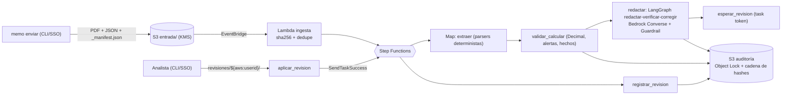

# memo-credito

Genera **borradores** de memos de crédito para PyMEs a partir de los estados de cuenta, la constancia de situación fiscal, los estados financieros y la solicitud en JSON. El analista revisa y edita; el comité decide. **El sistema nunca aprueba ni recomienda**: no existe un estado "aprobado".

- **Cifras exactas y reproducibles.** Todo se calcula con `Decimal` y `ROUND_HALF_UP` en un núcleo determinista. El LLM solo redacta la prosa y cita las cifras con marcadores `{{id}}`, que el código sustituye.
- **Auditable.** Cada memo deja un paquete inmutable (S3 Object Lock con cadena de hashes) desde el que se recalcula el análisis byte a byte.
- **Seguro.**
  - El LLM no ve texto crudo ni PII.
  - El guardrail de Bedrock es obligatorio por IAM.
  - La identidad del revisor la impone IAM.
  - No hay secretos en el repo, el pipeline ni las Lambdas.

## Resultados medidos (dev, 2026-11-25)

- **Evals reales** con Sonnet 4.6 y el guardrail desplegado: **40/40** (5 corridas × 8 casos), USD 0.024 por memo en promedio. El candado del prompt está aprobado.
- **Punta a punta en AWS**: unos 18 s hasta el borrador con el LLM simulado y 37 s con Bedrock dentro de la Lambda. La revisión por la CLI termina en `LISTO_PARA_COMITE` con la identidad impuesta por IAM.
- **Carga**: 100 expedientes en ráfaga con concurrencia de Lambda de 10, 100/100 en `PENDIENTE_REVISION`, p95 de 41.8 s.
- **Guardrail desplegado**: 5/5 casos de prueba. Integración contra dev: 7 pasan y 2 negativos requieren el rol de OIDC.
- **Bugs encontrados al desplegar y medir**, todos corregidos con pruebas: el payload literal del Map, el throttling sin reintento en `EsperarRevision`, los falsos positivos del tema del guardrail y el código de alerta leído como cifra (`docs/registro_proceso.md`).

## Arquitectura



- Diagrama del grafo de redacción, generado desde el código: [`docs/grafo_redaccion.mmd`](docs/grafo_redaccion.mmd).
- Plan completo: [`docs/plan_implementacion.md`](docs/plan_implementacion.md).
- Decisiones: [`docs/adr/`](docs/adr/).

## Revisar la solución sin desplegar (5 pasos, sin credenciales)

Requisitos: Python 3.12, [uv](https://docs.astral.sh/uv/) y Node 22 (solo para la CLI de CDK). No hace falta Docker. En Windows funciona sin `make`.

```bash
uv run python tareas.py setup      # 1. dependencias exactas (uv.lock y package-lock.json) y pre-commit
uv run python tareas.py check      # 2. ruff, mypy y ~200 pruebas: goldens, adversariales, arquitectura, handlers (moto), infra con cdk-nag
uv run python tareas.py evals      # 3. evals de los 8 casos con LLM simulado y scorecard en evals/scorecards/
uv run python tareas.py procesar   # 4. memos en salidas/SOL-000X/memo.md y paquete de auditoría local
uv run python tareas.py synth      # 5. paquete Lambda arm64 y plantillas de CloudFormation con cdk-nag (cdk.out/)
```

Después: `uv run memo evidencia SOL-0001 capacidad_pago` muestra la fórmula y las entradas de un indicador (las alertas citan página y renglón del PDF), y `uv run memo auditoria SOL-0001` verifica la cadena de hashes. Con `make` existen los mismos objetivos (`make check`, `make deploy ENV=dev PROFILE=<perfil>`).

## Desplegar en dev

```bash
# Una vez por cuenta y región (calificador propio, ADR-0011)
npx cdk bootstrap --qualifier memocred --toolkit-stack-name CDKToolkit-memocred --profile <perfil>

uv run python tareas.py deploy --entorno dev --perfil <perfil>            # 3 stacks: datos, flujo, observabilidad
uv run python tareas.py probar-guardrail --entorno dev --perfil <perfil>  # ApplyGuardrail con textos sintéticos
uv run python tareas.py smoke --entorno dev --perfil <perfil>             # SOL-0001 de punta a punta hasta PENDIENTE_REVISION
uv run python tareas.py integracion --entorno dev --perfil <perfil>       # SOL-0001, 0004, 0006 y 0007 con revisión completa
```

Dev usa el LLM simulado por defecto. Para usar Bedrock en un envío, añade `--modo-llm bedrock` a `memo enviar` (solo dev permite ese override). El modelo es `us.anthropic.claude-sonnet-4-6`, con Sonnet 5.5 como objetivo cuando la cuenta tenga acceso (ADR-0006). Prod usa Bedrock, VPC aislada y Object Lock en modo COMPLIANCE, y solo se despliega por el pipeline con aprobación manual.

## Revisión del analista

```bash
uv run memo --entorno dev pendientes
uv run memo --entorno dev descargar SOL-0001 --dir rev/          # memo borrador; edítalo si hace falta
uv run memo --entorno dev revisar SOL-0001 --decision listo_para_comite \
    --calificacion resumen=5 --calificacion observaciones=4 [--memo-final rev/SOL-0001.md] [--comentario "..."]
```

La revisión se escribe en `revisiones/<tu aws:userid>/…` (IAM no permite otro prefijo). `aplicar_revision` valida el hash del borrador vigente y envía el task token. El estado final es `LISTO_PARA_COMITE` o `REQUIERE_CAMBIOS`, y la revisión queda en DynamoDB, en la auditoría y en las métricas de retroalimentación.

## Reglas del repositorio

[`AGENTS.md`](AGENTS.md) contiene las 12 reglas obligatorias para personas y asistentes de código. Entre ellas:

- `Decimal` en lugar de `float`.
- Nada de texto crudo ni PII hacia el LLM o los logs.
- Toda alerta nueva lleva pruebas y caso de eval.
- Todo permiso IAM nuevo lleva su prueba en `tests/infra/permisos_esperados.json`.
- Bedrock se llama solo con boto3 Converse.
- Candado de evals para prompts y modelo.

## Documentación

| Documento | Contenido |
|---|---|
| [`docs/plan_implementacion.md`](docs/plan_implementacion.md) | Plan de 26 secciones: arquitectura, contratos, costos, evals, seguridad, CI/CD |
| [`docs/datos.md`](docs/datos.md) | Hallazgos verificados al centavo en los 8 expedientes |
| [`docs/arquitectura.md`](docs/arquitectura.md) | Flujo, estados, componentes, datos y su retención, seguridad |
| [`docs/adr/`](docs/adr/) | ADR-0001 a ADR-0012 |
| [`docs/implementado_vs_propuesto.md`](docs/implementado_vs_propuesto.md) | Qué está en el código y desplegado, y qué es propuesta |
| [`docs/runbook.md`](docs/runbook.md) | Seis síntomas con diagnóstico y acción |
| [`docs/modelo_amenazas.md`](docs/modelo_amenazas.md) | 17 amenazas, controles y evidencia |
| [`docs/escalamiento.md`](docs/escalamiento.md) | Carga, cuotas y escenario de 10 veces más volumen |
| [`docs/registro_proceso.md`](docs/registro_proceso.md) | Bitácora: hallazgos, bloqueos de cuotas y modelos, uso de IA |
| [`docs/presentacion.md`](docs/presentacion.md) | Presentación de 10 diapositivas |
