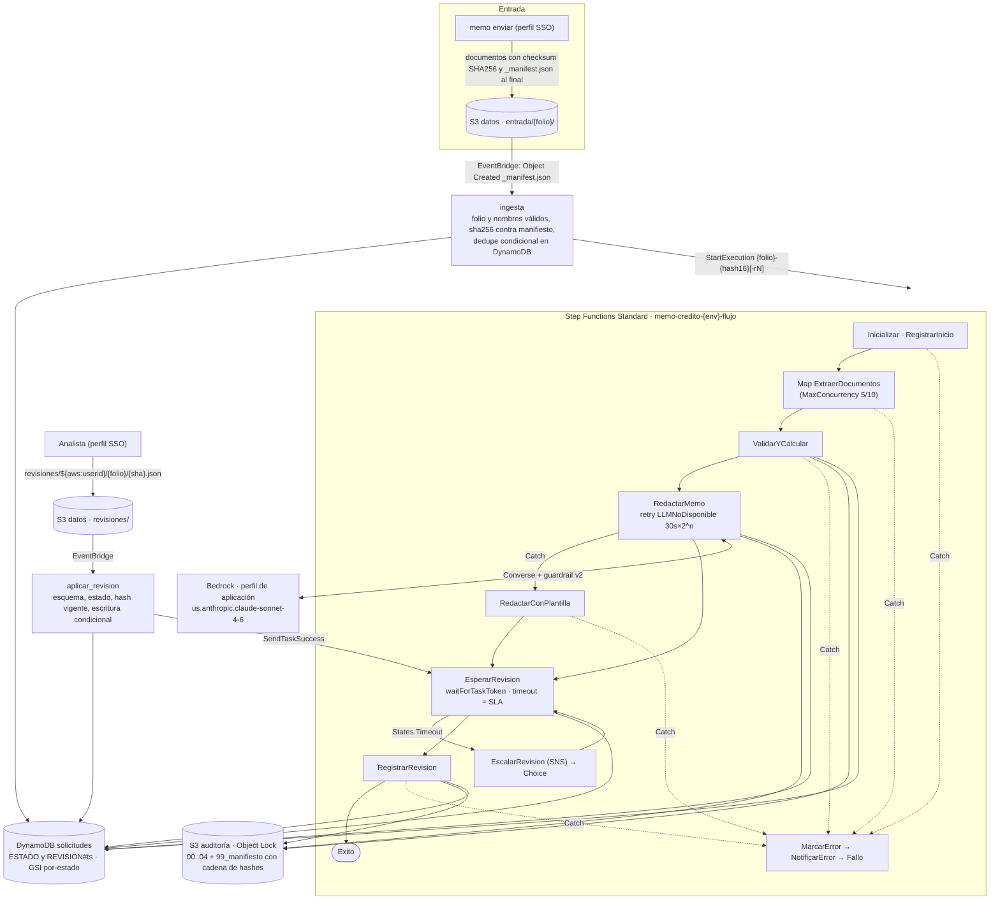

# Arquitectura implementada

Este documento describe lo que está en el código y desplegado en dev. El razonamiento completo está en `docs/plan_implementacion.md` (§5 y §17) y en los ADR.

## Flujo

## Estados de una solicitud

`RECIBIDA` → `PROCESANDO` → `MEMO_GENERADO` → `PENDIENTE_REVISION` → `REVISION_RECIBIDA` → `LISTO_PARA_COMITE` o `REQUIERE_CAMBIOS`.

Las salidas por excepción son:

- `ERROR`, con `motivo`;
- `REVISION_VENCIDA`, cuando se agotan los escalamientos.

No existe ningún estado "aprobado".

## Componentes

| Componente | Responsabilidad | Detalles |
|---|---|---|
| `ingesta` | Valida el manifiesto y arranca la ejecución | Asíncrona desde EventBridge, con DLQ y destino de fallo; interruptor `modo_llm` (override solo en dev) |
| `extraer` | Una iteración del Map por documento | Verifica el sha256 antes de parsear; los rechazos no detienen el flujo |
| `validar_calcular` | Expediente, validaciones, alertas, indicadores en `Decimal` y hechos | Escribe las partes 00 a 02 de la auditoría |
| `redactar` | Grafo de LangGraph con Bedrock o simulado, verificador y ensamblado | Idempotente (Powertools); propaga el throttling para que reintente Step Functions; parte 03 |
| `esperar_revision` | Guarda el task token y deja `PENDIENTE_REVISION` | Tabla cifrada con KMS |
| `aplicar_revision` | Valida la revisión y envía el token | La identidad sale de la clave impuesta por IAM |
| `registrar_revision` | Métricas de retroalimentación, candidatos de eval, estado final | Partes 04 y 99; memo final en la auditoría solo si cambió y no trae PII |

## Datos y clasificación

| Lugar | Contenido | Retención |
|---|---|---|
| `datos/entrada/` | Documentos originales y manifiesto (PII) | 7 días en dev y 90 en prod; versiones previas, 7 días |
| `datos/trabajo/` | Extracciones, contexto, memo y memo final | 30 días en dev y 365 en prod |
| `datos/revisiones/` | Revisiones del analista | 30 días en dev y 365 en prod |
| `auditoria/` | Paquete sin PII (hashes y proyección) | Object Lock: GOVERNANCE de 1 día en dev y COMPLIANCE de 3,650 días en prod |
| DynamoDB `solicitudes` | Estado, hashes, token y revisiones (sin PII) | PITR |
| Logs | JSON sin PII, con `correlation_id` | 14 días en dev y 180 en prod; data protection en prod |

## Seguridad (resumen)

- **Cifrado:** una llave KMS por entorno, con rotación, para S3, DynamoDB, SNS, SQS y logs. TLS obligatorio en buckets y tópicos.
- **Permisos por función:** cada Lambda tiene su rol con acciones explícitas. El inventario está aprobado en `tests/infra/permisos_esperados.json` (regla 6) y cdk-nag 3 está limpio.
- **Bedrock:** solo `redactar` lo invoca, y un `Deny` exige el guardrail propio.
- **Personas:** políticas administradas para analista, comité, auditor y operación (§16.2), con `${aws:userid}` para el analista.
- **Red de prod:** subredes aisladas sin NAT, endpoints de gateway y de interfaz, y egreso solo por el puerto 443.
